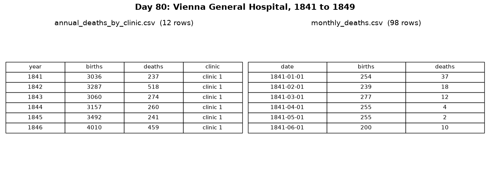

# 🚀 080 Dr Semmelweis Handwashing Discovery

Day 80 of Udemy's *100 Days of Code: The Complete Python Pro Bootcamp*, as a tested, documented Python 3.13+ project: you play Dr Ignaz Semmelweis and use pandas, Matplotlib and SciPy to show that handwashing saved lives at the Vienna General Hospital. It is for fellow course participants who want to compare solutions, and for visitors looking for ideas.

## 📚 Table of Contents

- [Overview](#-overview)
- [Requirements](#-requirements)
- [Setup](#-setup)
- [Run](#-run)
- [Tests](#-tests)
- [License](#-license)
- [Links](#-links)
- [Appendix: Project documents](#-appendix-project-documents)

## 🧭 Overview

The project follows the six lecture steps of Day 80 (lectures 591 to 596). Each step has code in `src/semmelweis`, tests in `tests/`, a section in the notebook in `notebooks/`, a picture generated from the code, and a wiki page in English, Danish and Bahasa Malaysia that explains what the step teaches.

| Folder | What it holds |
| --- | --- |
| `src/semmelweis/` | The package: `constants.py`, `domain/` (the analysis rules), `infrastructure/` (reading the data), `presentation/` (charts and pictures), `data/` (the two CSV files from the course) |
| `tests/` | pytest tests that check every figure the lectures state |
| `notebooks/` | The course's own start notebook and the solution notebook (Jupyter) |
| `docs/` | Project documents, the wiki sources in `docs/wiki/` and the pictures in `docs/images/` |

### Lecture steps

| Lecture | Wiki page | Picture |
| --- | --- | --- |
| 591 Day 80 goals | [Step 1](https://git.tirsystem.com/Tirsvad-Udemy-100-days-of-code/080-Dr-Semmelweis-Handwashing-Discovery/wiki/Step-1-Goals) |  |

The data and the start notebook come from the course resources and are used here for personal study; the rights stay with the course author.

## 📋 Requirements

- Python 3.13 or newer, to run the code.
- Git, to clone the repository.
- Runtime dependencies: `pandas`, `numpy`, `matplotlib` and `scipy`, installed by `pip`. Nothing else is needed to run the analysis.
- Optional: `pytest` and `ruff` (the `dev` extra); `jupyterlab`, `plotly` and `seaborn` (the `notebook` extra, for the notebooks); Doxygen, to build the API pages; opengrep, to check the code before a push.

## 🛠️ Setup

Create and use a local `.venv`, then install the project in editable mode.

Windows (PowerShell):

```powershell
git clone https://git.tirsystem.com/Tirsvad-Udemy-100-days-of-code/080-Dr-Semmelweis-Handwashing-Discovery.git
cd 080-Dr-Semmelweis-Handwashing-Discovery
python -m venv .venv
.venv\Scripts\Activate.ps1
python -m pip install --upgrade pip
python -m pip install -e ".[dev]"
```

Linux and macOS:

```bash
git clone https://git.tirsystem.com/Tirsvad-Udemy-100-days-of-code/080-Dr-Semmelweis-Handwashing-Discovery.git
cd 080-Dr-Semmelweis-Handwashing-Discovery
python3 -m venv .venv
source .venv/bin/activate
python -m pip install --upgrade pip
python -m pip install -e ".[dev]"
```

The wiki page [Getting Started](https://git.tirsystem.com/Tirsvad-Udemy-100-days-of-code/080-Dr-Semmelweis-Handwashing-Discovery/wiki/Getting-Started) has the same steps with notes for each system.

## ▶️ Run

With the `.venv` active, draw the pictures of the lecture steps, or open the notebook:

```bash
python -m semmelweis.presentation.screenshots
python -m pip install -e ".[notebook]"
jupyter lab notebooks
```

Build the API pages with `doxygen Doxyfile` (output in `docs/doxygen/html`).

## 🧪 Tests

```bash
python -m pytest
python -m ruff check src tests
```

Before every push, check the code with opengrep:

```bash
~/.opengrep/cli/latest/opengrep scan --config p/python src tests
```

## 📄 License

GNU Affero General Public License v3.0; see [LICENSE][license].

## 🔗 Links

- [Repository][repository]
- [Documentation][documentation]
- [Issue tracker][issues]

## 📎 Appendix: Project documents

The documents a newcomer needs, in reading order.

| Document | What it tells you |
| --- | --- |
| [Business Case][BC-001] | Why the project exists, its scope and success criteria |
| [Stakeholder Analysis][SA-001] | Who is involved; the stakeholder IDs used for owners and reviewers |
| [Project Plan][PP-001] | The gateways and their schedule |
| [Milestones][milestones] | One document per gateway: Go/No-Go criteria and tasks |
| [Artifact registry][registry] | Where each artifact type lives, the next version, the PO language and domain |
| [Traceability matrix][TM-001] | How the artifacts link and when each was last reviewed |
| [Framework README][framework-readme] | The framework this project uses |
| [Framework changelog][framework-changelog] | What changed in each framework release |

---

[license]: ./LICENSE
[repository]: https://git.tirsystem.com/Tirsvad-Udemy-100-days-of-code/080-Dr-Semmelweis-Handwashing-Discovery
[documentation]: https://git.tirsystem.com/Tirsvad-Udemy-100-days-of-code/080-Dr-Semmelweis-Handwashing-Discovery/wiki
[issues]: https://git.tirsystem.com/Tirsvad-Udemy-100-days-of-code/080-Dr-Semmelweis-Handwashing-Discovery/issues
[BC-001]: ./docs/business-case.md
[SA-001]: ./docs/stakeholder-analysis.md
[PP-001]: ./docs/project-plan.md
[milestones]: ./docs/milestones/
[registry]: ./docs/artifact-registry.md
[TM-001]: ./docs/sqa/traceability-matrix.md
[framework-readme]: ./framework/README.md
[framework-changelog]: ./framework/CHANGELOG.md
