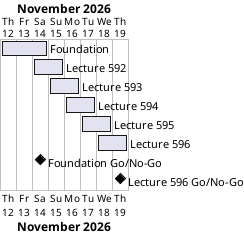

# Project Plan

## Metadata
| Key | Value |
| --- | --- |
| ID | PP-001 |
| CrossReference | [BC-001], [SA-001], [MIL-001], [MIL-002], [MIL-003], [MIL-004], [MIL-005], [MIL-006] |
| Language | en |
| Domain | it |

## Version History
| Date | Status | Author | Reviewer | Change | Commit |
| --- | --- | --- | --- | --- | --- |
| 2026-11-12 | Accepted | Jens Tirsvad Nielsen | AI as stand-in for S01 | Initial version, accepted by S01 as Product Owner in chat on 2026-11-12 | [ec941c9] |

---

## Purpose

This plan schedules the six gateways that take the Day 80 course assignment (lectures 591 to 596) from an empty repository to a tested, documented and published project. The Business Case sets no hard deadline; the plan uses a one-week personal schedule.

## Planning Assumptions

- The plan starts 2026-11-12 and ends by 2026-11-19.
- One gateway per lecture step, plus a foundation gateway; one branch and one pull request per gateway.
- The reviewer is S01; in autonomous mode the AI acts as stand-in and records it in each `RC-*`.

## Gateway Schedule

| Gateway | Document | Window | Decision date | Owner | Stories | Main deliverable | Milestone |
| --- | --- | --- | --- | --- | --- | --- | --- |
| Foundation (lecture 591) | [MIL-001] | 2026-11-12 to 2026-11-14 | 2026-11-14 | S01 | none | Skeleton, tooling, data, README, Getting Started wiki, repository metadata | |
| Lecture 592 | [MIL-002] | 2026-11-14 to 2026-11-15 | 2026-11-15 | S01 | none | Data exploration, 7.08 % result, births and deaths chart | |
| Lecture 593 | [MIL-003] | 2026-11-15 to 2026-11-16 | 2026-11-16 | S01 | none | Clinic split analysis and charts | |
| Lecture 594 | [MIL-004] | 2026-11-16 to 2026-11-17 | 2026-11-17 | S01 | none | Handwashing effect and highlighted time series | |
| Lecture 595 | [MIL-005] | 2026-11-17 to 2026-11-18 | 2026-11-18 | S01 | none | Histograms, KDE and p-value test | |
| Lecture 596 | [MIL-006] | 2026-11-18 to 2026-11-19 | 2026-11-19 | S01 | none | Summary, wiki completeness, final verification | |



## Scope Coverage

| Business Case scope item | Gateway |
| --- | --- |
| Python 3.13+, venv, pyproject, .gitignore, constants.py, Doxygen, Doxyfile | [MIL-001] |
| Data files and notebook | [MIL-001] |
| Code and tests for lectures 592 to 595 | [MIL-002], [MIL-003], [MIL-004], [MIL-005] |
| README, wiki in en, da and ms, screenshots per lecture step | [MIL-001] to [MIL-006] |
| Getting Started with Linux and Windows guides | [MIL-001] |
| opengrep before each push | every gateway |
| Repository description and topics | [MIL-001] |

## Dependencies

```
MIL-001 → MIL-002 → MIL-003 → MIL-004 → MIL-005 → MIL-006
```

A No-Go on a gateway moves every later date by the rework time.

## Plan Risks

| Risk | Impact | Mitigation |
| --- | --- | --- |
| Udemy session expires, blocking screenshots | Delay | Ask the user to sign in again in Chrome |
| Three-language wiki takes longer than code | Delay | Translate page by page right after each lecture step |
| Lecture figures differ from computed values | Rework | Compute from the CSV data first and assert what the data gives; record any difference |

## Open Issues

- The architecture decision record (ADR) for skipping use cases, user stories and the presentation pattern is a task of [MIL-001].
- The lecture 591 resources link is read from the lecture page when the foundation is built.

---

[BC-001]: ./business-case.md
[SA-001]: ./stakeholder-analysis.md
[MIL-001]: ./milestones/mil-001-foundation.md
[MIL-002]: ./milestones/mil-002-lecture-592-data-exploration.md
[MIL-003]: ./milestones/mil-003-lecture-593-clinic-split.md
[MIL-004]: ./milestones/mil-004-lecture-594-handwashing-effect.md
[MIL-005]: ./milestones/mil-005-lecture-595-distributions-significance.md
[MIL-006]: ./milestones/mil-006-lecture-596-summary-release.md
[ec941c9]: https://git.tirsystem.com/Tirsvad-Udemy-100-days-of-code/080-Dr-Semmelweis-Handwashing-Discovery/commit/ec941c902d71a90670b723ceb117c73121ec236c
